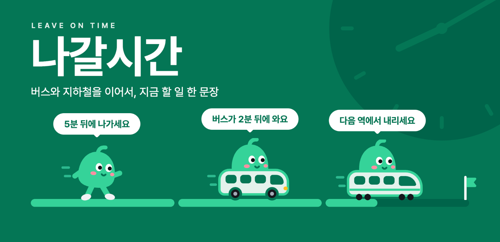
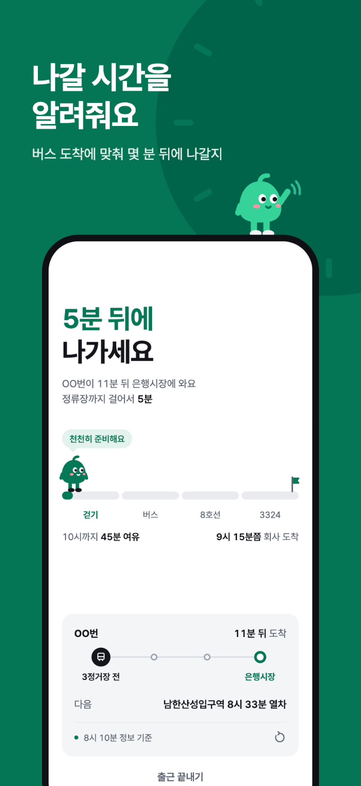
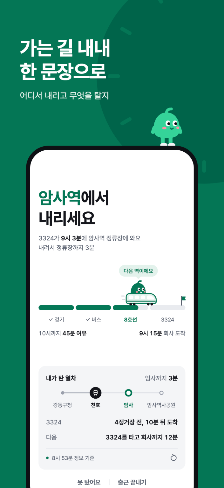
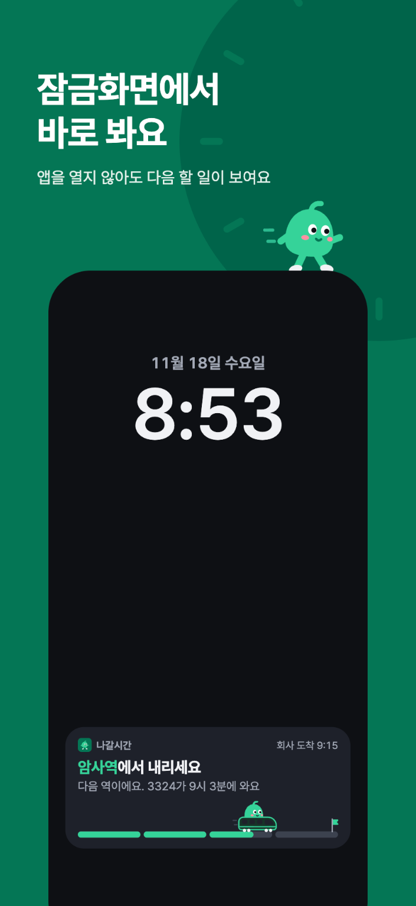
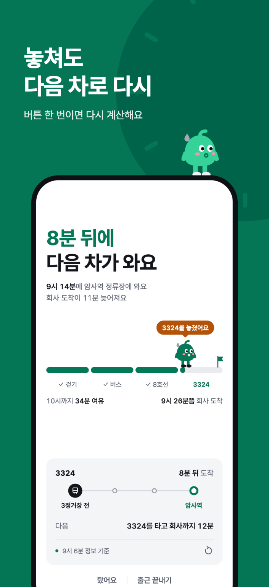
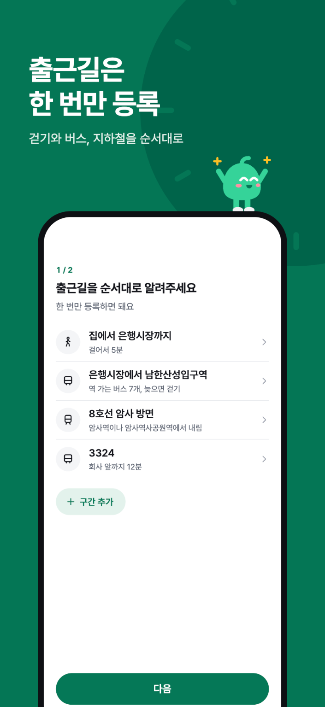

  

<h1 align="center">출퇴근길, 지금 할 일을 한 문장으로</h1>

  버스와 지하철을 이어서 언제 나가고 어디서 내릴지 알려드려요. 
  지도를 들여다보지 않아도 돼요. 그때그때 할 일만 알려드려요.

  
  

## 가는 길의 세 순간

<table>
  <tr>
    <th width="33%">나갈 시간</th>
    <th width="33%">탈 차</th>
    <th width="33%">내릴 역</th>
  </tr>
  <tr>
    <td align="center"><b>5분 뒤에 나가세요</b></td>
    <td align="center"><b>버스가 2분 뒤에 와요</b></td>
    <td align="center"><b>다음 역에서 내리세요</b></td>
  </tr>
  <tr>
    <td>버스 도착에 맞춰 집에서 나갈 시각을 알려드려요.</td>
    <td>어느 버스와 열차를 탈지 골라드려요. 걷는 쪽이 더 빠르면 걷기를 권해요.</td>
    <td>갈아탈 버스 시각에 맞춰 어느 역에서 내릴지 알려드려요.</td>
  </tr>
</table>

## 화면

<table>
  <tr>
    <td></td>
    <td></td>
    <td></td>
    <td></td>
    <td></td>
  </tr>
  <tr>
    <td align="center">나갈 시간을 알려줘요</td>
    <td align="center">가는 길 내내 한 문장으로</td>
    <td align="center">잠금화면에서 바로 봐요</td>
    <td align="center">놓쳐도 다음 차로 다시</td>
    <td align="center">출근길은 한 번만 등록</td>
  </tr>
</table>

## 쓰는 법

1. **출근길을 한 번 등록해요.** 걷기와 버스, 지하철을 순서대로 넣어요.
2. **출근 시작을 눌러요.** 평일 아침에는 알림으로 먼저 물어봐요.
3. **문장대로 움직여요.** 차를 놓치면 버튼 한 번으로 다시 계산해요.

앱을 열지 않아도 다음 할 일이 잠금화면에 떠요. 캐릭터가 출근길 어디쯤인지 보여줘요.

## 지키는 것

- 계정을 만들지 않습니다.
- 위치 정보를 쓰지 않습니다.
- 출근하는 동안 서버로 보낸 값은 도착하면 지웁니다.

   
  LEAVE ON TIME 
  교통 정보: 국토교통부, 서울특별시, 서울교통공사

